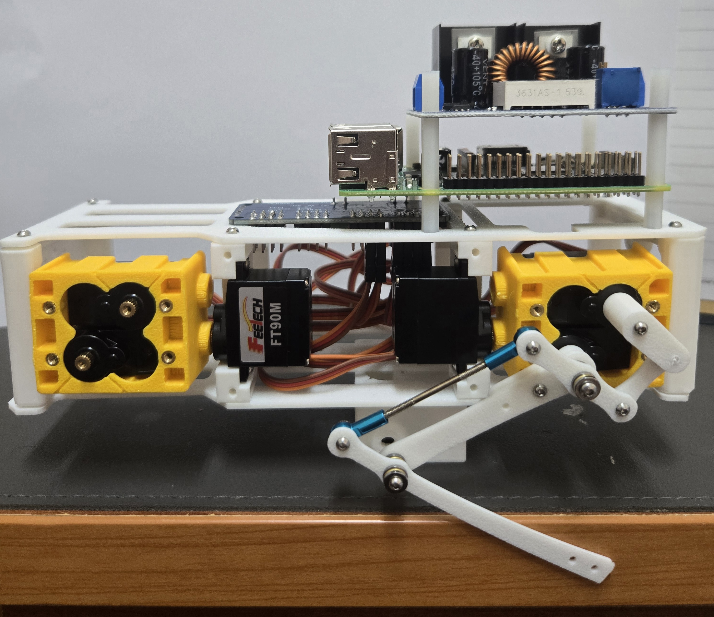
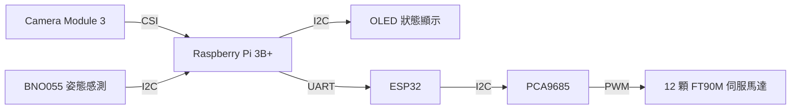

# Embedded Linux & Robotics Portfolio

嵌入式 Linux、Raspberry Pi 與電腦視覺實作作品集，記錄課程實驗、問題分析，以及機器狗從提案走向實體組裝的過程。

> 收錄 Lab1–12 的程式、報告與相關素材，以及機器狗實體組裝照片與[期末系統設計報告](docs/mini-pupper-system-design.pdf)。

## 精選項目

| 項目 | 內容與技術 |
| --- | --- |
| 機器狗組裝與整合規劃 | 實體組裝、接線規劃、元件需求、後續程式調整規劃 |
| 車牌辨識實驗（Lab12） | Raspberry Pi、Python、OpenCV、OpenALPR、模板比對 |
| 行人與車輛偵測實驗（Lab11） | OpenCV、HOG + SVM、非極大值抑制、車輛分類器 |
| 嵌入式 Linux 學習紀錄 | 交叉編譯、遠端除錯、系統建置、裝置驅動相關實驗 |

## 機器狗：從期末提案到實體組裝

*由我獨立完成的機器狗實體組裝，展示機構、伺服馬達與電路板配置。*

期末專題以系統提案為主，不要求一定完成實體作品。我仍進一步動手組裝機器狗，將提案推進至可展示的實體組裝階段。

### 我的貢獻

- 獨立完成機器狗實體組裝。
- 預先規劃接線方式與所需元件。
- 規劃後續程式碼調整與系統整合工作。

### 系統設計：讓影像處理與馬達控制分工

本提案參考 Mini Pupper 架構，規劃以 Raspberry Pi 3B+、ESP32 與 PCA9685 組成分層控制系統，取代直接使用官方 CustomBoard 的方式。實體組裝已完成；以下為報告中的系統整合與軟體實作規劃。

| 模組 | 元件與介面 | 設計用途 |
| --- | --- | --- |
| 影像與上層控制 | Raspberry Pi 3B+、Camera Module 3（CSI） | 使用 Python、Picamera2 與 OpenCV 擷取影像，辨識指定顏色物體並計算目標中心點。 |
| 關節控制 | ESP32、PCA9685、12 顆 FT90M 伺服馬達 | Pi 透過 UART 傳送指令，ESP32 經 I2C 控制 PCA9685，輸出 PWM 驅動每腳 3 個關節。 |
| 姿態與狀態顯示 | BNO055 IMU、SSD1306 OLED（I2C） | 讀取左右傾斜、前後傾斜與朝向角度，確認感測器校正狀態，並顯示 IP 或系統資訊。 |
| 電源分配 | 7.4V 電池、XL4016、LM2596 | 規劃將馬達與控制板分路供電，以降低伺服馬達大電流對主控板的影響；實際接線前需依各模組規格確認供電與邏輯電位。 |

### 軟體與測試規劃

- **顏色目標辨識**：擷取影像後轉換至 HSV 色彩空間，使用顏色遮罩與輪廓偵測找出目標，將中心點提供給後續控制流程。
- **姿態與步態控制**：讀取 BNO055 的 Roll／Pitch／Yaw，先校正伺服初始角度，再測試左右對角腳交替移動的 Trot 步態，規劃以姿態回授調整動作。
- **逐步整合驗證**：依序檢查電源、Camera／IMU／OLED、板間通訊、單顆伺服、單腳協同動作，最後測試四腳站立與步態。

[閱讀完整期末報告：基於 Mini Pupper 架構智慧四足機械狗系統設計（PDF，17 頁）](docs/mini-pupper-system-design.pdf)

## 車牌辨識：分析錯誤並提出改善

Lab12 實驗涵蓋 Raspberry Pi 環境建置、OpenALPR 測試，以及 OpenCV 車牌影像處理流程：

影像輸入 → 灰階與濾波 → 邊緣與輪廓偵測 → 透視校正 → 二值化 → 字元切割 → 模板比對。

報告記錄了字元誤判問題，並加入字元標準化、模板旋轉比對，以及「前三碼英文、後四碼數字」的格式限制。

## 行人與車輛偵測：遠端執行與結果輸出

Lab11 使用 OpenCV 的 HOG + SVM 行人偵測器、非極大值抑制，以及車輛分類器，將偵測結果標示並輸出為影像。

實驗紀錄包含影像路徑錯誤排查，以及 SSH 無圖形介面時改以檔案輸出結果的處理經驗。

## Lab 資料夾導覽

| 實驗 | 資料夾 | 內容與技術摘要 |
| --- | --- | --- |
| Lab1 | [lab1](lab1/) | **建置 ARM 交叉編譯環境**：在 Ubuntu 從原始碼建置 Binutils、GCC 與 Glibc，設定 Sysroot（目標系統的標頭檔與函式庫目錄），將 C 程式編譯成 ARM 執行檔，並用 `file` 確認架構。 |
| Lab2 | [lab2](lab2/) | **遠端除錯 ARM 程式**：建置交叉除錯器 GDB，以 QEMU 模擬執行 ARM 程式；透過遠端連線設定中斷點、單步執行與查看變數，練習在開發電腦追蹤目標程式的執行過程。 |
| Lab3–4 | [lab3-4](lab3-4/) | **製作可開機的精簡 Linux 系統**：使用 Buildroot 為 Raspberry Pi 3 建置核心與根檔案系統，透過 `menuconfig`、BusyBox 配置主機名稱與工具，產生 SD 卡映像檔，再以 `dd` 燒錄並進行開機測試。 |
| Lab5 | [Lab5](Lab5/) | **配置 SD 卡開機與系統分割區**：使用 `fdisk` 調整分割區，配置 FAT32 開機區與 Linux 根檔案系統區，放入韌體、核心及裝置樹檔案，練習格式化、掛載與系統映像寫入。 |
| Lab6 | [Lab6](Lab6/) | **備份 Linux 根檔案系統**：以 `dd` 建立映像檔，透過 `losetup` 將檔案當成虛擬磁碟，建立並掛載 ext4 檔案系統；使用 `rsync` 複製系統內容並保留權限與連結，準備可供還原的備份。 |
| Lab7 | [Lab7](Lab7/) | **理解並新增系統呼叫**：用 `objdump` 反組譯觀察程式如何進入 Linux 核心，加入自訂 system call 後重新編譯核心，再以 C 測試程式與 `dmesg` 檢查回傳值及核心訊息。 |
| Lab8 | [Lab8](Lab8/) | **實作 Linux 字元裝置驅動**：編寫可載入的核心模組，註冊字元裝置並建立 `/dev/demo`，將應用程式的開啟、讀取、寫入與關閉操作對應到驅動函式；用 `insmod`、`rmmod` 與 `dmesg` 測試。 |
| Lab9 | [Lab9](Lab9/) | **用程式控制實體 LED**：以 C 與 libgpiod 操作 Raspberry Pi 的 GPIO4，讓 LED 每隔一秒切換亮滅；練習 GPIO 輸出設定、LED／電阻接線，以及程式結束時釋放硬體資源。 |
| Lab10 | [Lab10](Lab10/) | **控制四位數七段顯示器**：以 C、libgpiod 和 GPIO 的 CLK／DIO 訊號控制 TM1637，實作數字編碼、資料傳送及清空顯示；完成每秒減 100 的倒數，並延伸為學號跑馬燈。 |
| Lab11 | [Lab11](Lab11/) | **影像處理與行人／車輛偵測**：使用 Python、OpenCV 與 NumPy 進行縮放、灰階及對比增強，以 HOG + SVM 偵測行人、NMS 合併重疊框，搭配級聯分類器偵測車輛，輸出標示結果的圖片與影片。 |
| Lab12 | [Lab12](Lab12/) | **車牌定位與字元辨識**：測試 OpenALPR，並以 Python／OpenCV 串接邊緣偵測、輪廓定位、透視校正、二值化、字元切割與模板比對；針對誤判加入字元標準化、旋轉比對及車牌格式限制。 |

## 閱讀與重現

各 Lab 保留原始資料夾結構，包含現有程式、報告、講義及素材。

## 來源與貢獻說明

Linux 與電腦視覺項目源自課程實驗。資料夾包含課程範例、講義、第三方工具與個人實驗報告；各檔案保留原始內容，相關著作權與授權依原來源為準。機器狗目前的個人實作範圍為實體組裝與整合規劃。
